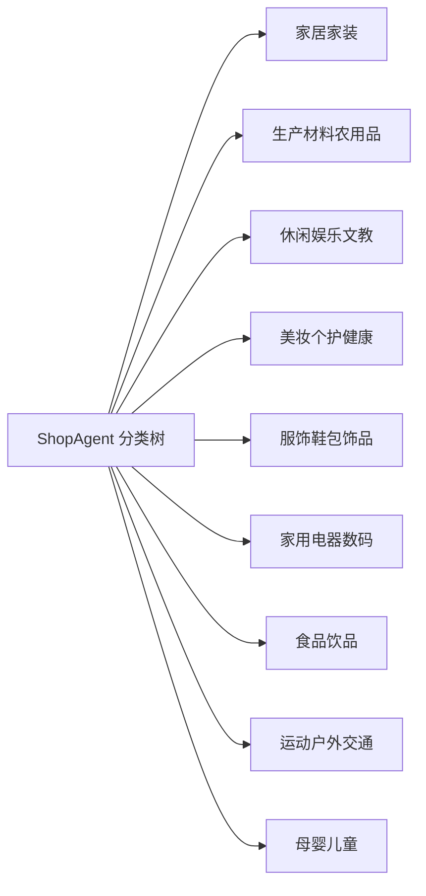

# ShopAgent 当前分类树说明

> 统计日期：2026-09-20  
> 全量口径：`items_eval_train.json` 前 1495 条测试任务  
> 当前评测样本：`data/final_test_100.jsonl` 中的 100 条任务

## 1. 一句话结论

当前分类体系共有 **9 个业务大类、78 个一级场景、182 个二级场景、224 条叶子类目路径**。

当前使用的 100 题评测集是从前 1495 条测试任务中随机抽取的样本，并不是一套独立分类树；它实际覆盖了 **9 个大类、52 个一级场景、83 条叶子类目路径**。

## 2. 分类树是怎样组织的

数据中没有单独的 `scene` 字段。为了便于阅读，本文把 `category` 路径的第一段称为“一级场景”，第二段称为“二级场景”，最后一段称为“叶子类目”。实际结构如下：

```text
业务大类（domain_zh）
└── 一级场景（category 第 1 段）
    └── 二级场景（category 第 2 段）
        └── 细分类目（可选）
            └── 叶子类目 / 具体商品类型
```

例如：

```text
家居家装
└── 厨房/烹饪用具
    └── 烹饪用具
        └── 锅具/煲/烧水壶
            └── 煎锅/平底锅
```

`category` 的深度并不固定，目前为 2～4 层；因此，判断具体商品类型时应取路径最后一段，而不应写死为某一级。

## 3. 九个大类总览

| 大类 | 全量任务 | 占比 | 一级场景数 | 叶子类目数 | 当前 100 题 | 当前一级场景覆盖 | 当前叶子路径覆盖 |
|---|---:|---:|---:|---:|---:|---:|---:|
| 家居家装 | 274 | 18.3% | 12 | 41 | 16 | 8 / 12 | 13 / 41 |
| 生产材料农用品 | 209 | 14.0% | 12 | 30 | 21 | 9 / 12 | 16 / 30 |
| 休闲娱乐文教 | 205 | 13.7% | 11 | 29 | 12 | 7 / 11 | 11 / 29 |
| 美妆个护健康 | 194 | 13.0% | 8 | 30 | 13 | 6 / 8 | 11 / 30 |
| 服饰鞋包饰品 | 192 | 12.8% | 10 | 31 | 11 | 6 / 10 | 9 / 31 |
| 家用电器数码 | 174 | 11.6% | 9 | 25 | 10 | 5 / 9 | 9 / 25 |
| 食品饮品 | 88 | 5.9% | 5 | 13 | 6 | 3 / 5 | 5 / 13 |
| 运动户外交通 | 84 | 5.6% | 7 | 15 | 6 | 4 / 7 | 5 / 15 |
| 母婴儿童 | 75 | 5.0% | 4 | 10 | 5 | 4 / 4 | 4 / 10 |
| **合计** | **1495** | **100%** | **78** | **224** | **100** | **52 / 78** | **83 / 224** |



## 4. 各大类包含的场景

下面完整列出全量测试范围中的一级场景，以及每个一级场景下已出现的二级场景。

### 4.1 家居家装

| 一级场景 | 二级场景 |
|---|---|
| 家装主材 | 卫浴五金；晾衣架/晾衣杆；浴缸/淋浴房；浴霸 |
| 住宅家具 | 儿童家具；屏风/花窗；床类；沙发类 |
| 家居饰品 | 花瓶/花器/仿真花/仿真饰品；装饰画；贴饰 |
| 居家日用 | 家居智能设备；防护用品 |
| 家装灯饰光源 | 其它灯具灯饰；室外灯饰 |
| 全屋定制 | 地暖/暖气片/散热器；门 |
| 餐饮具 | 咖啡器具；杯子/水杯/水壶；茶具 |
| 床上用品 | 床品定制/定做(新)；枕头 |
| 厨房/烹饪用具 | 烧烤/烘焙用具；烹饪用具 |
| 基础建材 | 家用五金；涂料（乳胶漆） |
| 收纳整理 | 家庭收纳用具 |
| 居家布艺 | 地毯；窗帘门帘及配件；餐桌布艺 |

### 4.2 生产材料农用品

| 一级场景 | 二级场景 |
|---|---|
| 宠物/宠物食品及用品 | 全价狗主粮；宠物服饰及配件；水族食品及用品；狗零食；猫/狗医疗用品（非药品） |
| 鲜花速递/花卉仿真/绿植园艺 | 园艺用品；种子/种苗/球根 |
| 畜牧/养殖物资 | 兽药；水产养殖物资；饲料 |
| 工业油品/胶粘/化学/实验室用品 | 实验室设备；染料 |
| 农用物资 | 农用/环境用卫生农药；农药；肥料 |
| 清洗/食品/商业设备 | 清洗/清理设备；食品加工设备 |
| 五金/工具 | 手动工具；电气控制 |
| 金属材料及制品 | 金属丝/绳/缆；铝材 |
| 电子元器件市场 | 分立器件；多媒体与显示器件 |
| 搬运/仓储/物流设备 | 起重搬运设备 |
| 橡塑材料及制品 | 塑料型材；非金属材料及制品 |
| 农机/农具/农膜 | 喷灌/滴灌设备 |

### 4.3 休闲娱乐文教

| 一级场景 | 二级场景 |
|---|---|
| 乐器/吉他/钢琴/配件 | 乐器配件；民族乐器 |
| ZIPPO/瑞士军刀/眼镜 | 光学眼镜；功能眼镜；品牌打火机及配件 |
| 文具电教/文化用品/商务用品 | 画具/画材用品；胶粘用品 |
| 商业/办公家具 | 公共休闲家具；办公家具；美妆家具 |
| 电玩/配件/游戏/攻略 | PSV专用配件；游戏手柄；游戏软件 |
| 节庆用品/礼品 | 创意礼品；婚庆用品；文化创意用品 |
| 玩具/童车/益智/积木/模型 | 童车/儿童轮滑；解锁/迷宫/魔方/智力玩具 |
| 特色手工艺 | 地区民间特色手工艺 |
| 办公设备/耗材/相关服务 | 传真/通信设备；其他打印设备 |
| 书籍/杂志/报纸 | 考试/教材/教辅/论文 |
| 模玩/动漫/周边/娃圈三坑/桌游 | Cosplay服饰/道具/服务；古风/国风服装 |

### 4.4 美妆个护健康

| 一级场景 | 二级场景 |
|---|---|
| 彩妆/香水/美妆工具 | 唇部彩妆；眼部彩妆；面部彩妆 |
| 美容美体仪器 | 口腔电子/智能产品；女士脱毛/剃毛器；电子美容仪（器械） |
| 美发护发/假发 | 假发；头发护理；染发烫发 |
| 个人护理/保健/按摩器材 | 按摩器材；美发工具 |
| 美容护肤/美体/精油 | 男士面部护理；眼部护理（新）；面膜（新）；面部磨砂/去角质 |
| 医疗器械 | 冲牙器／洗牙器／洁牙机；助听器 |
| OTC药品/国际医药 | 国际医药 |
| 洗护清洁剂/卫生巾/纸/香薰 | 衣物鞋包清洁剂/护理剂；身体护理 |

### 4.5 服饰鞋包饰品

| 一级场景 | 二级场景 |
|---|---|
| 运动鞋new | 棒球鞋；篮球鞋；羽毛球鞋；运动休闲鞋 |
| 运动服/休闲服装 | 健身服装；运动内衣；运动套装；运动裤 |
| 女鞋 | 时装单鞋；汉服鞋/绣花鞋/传统布鞋；靴子 |
| 饰品/流行首饰/时尚饰品新 | 半宝晶石；木作制品 |
| 珠宝/钻石/翡翠 | 小众天然玉石；黄金镶嵌首饰 |
| 服饰配件/皮带/帽子/围巾 | 制衣面料；运动首饰 |
| 箱包皮具/热销女包/男包 | 女士包袋新；胸包 |
| 黄金 | IP联名黄金；工艺黄金；黄金首饰（新） |
| 女装/女士精品 | 唐装/民族服装/舞台服装；套装/学生校服/工作制服 |
| 男装 | 夹克；西裤 |

### 4.6 家用电器数码

| 一级场景 | 二级场景 |
|---|---|
| 电脑硬件/显示器/电脑周边 | 客制化键盘套件；散热器/风扇；服务器/工作站/企业级配件；电脑周边 |
| 大家电 | 厨房大电；商用冷链；商用电视；移动空调 |
| 3C数码配件 | 便携电源；平板电脑配件；手机配件 |
| 生活电器 | 沙发/布艺/地毯清洗机；洗地机及配件/耗材；生活家电配件 |
| 影音电器 | 家庭影院配件；音箱/音响 |
| 电子/电工 | 接线板/插头；智能家居系统 |
| 厨房电器 | 制冰机；商厨制冷类设备；烤串机/电烤炉/电烤盘 |
| 数码相机/单反相机/摄像机 | 全景相机；普通数码相机 |
| 智能设备 | 智能翻译机 |

### 4.7 食品饮品

| 一级场景 | 二级场景 |
|---|---|
| 粮油调味/速食/干货/烘焙 | 烘焙原料/辅料/食品添加剂；调味品/果酱/沙拉/干副食；面点/西式速食 |
| 咖啡/麦片/冲饮 | 奶粉；速溶咖啡/咖啡豆/粉 |
| 茶 | 代用/花草/水果/再加工茶；茶粉/茶膏/茶精/茶液/茶蜜 |
| 奶粉/辅食/营养品/零食 | 婴童营养品 |
| 酒类 | 其他酒类；洋酒 |

### 4.8 运动户外交通

| 一级场景 | 二级场景 |
|---|---|
| 运动/瑜伽/健身/球迷用品 | 乒乓球；网球；羽毛球；跑步机/大型健身器械 |
| 电动车/配件/交通工具 | 电动车装备区 |
| 户外/登山/野营/旅行用品 | 垂钓钓竿；户外服装 |
| 自行车/骑行装备/零配件 | 自行车整车；自行车零/配件 |
| 汽车零部件/养护/美容/维保 | 冷却系统 |
| 汽车用品/电子/清洗/改装 | 汽车加装；汽车贴膜 |
| 摩托车/装备/配件 | 摩托车配件；船舶/装备/配件 |

### 4.9 母婴儿童

| 一级场景 | 二级场景 |
|---|---|
| 童装/婴儿装/亲子装 | 儿童户外服；外套/夹克/大衣 |
| 孕妇装/孕产妇用品/营养 | 乳房护理（新）；孕产妇护肤/洗护/祛纹 |
| 婴童用品 | 婴儿手推车/学步车 |
| 童鞋/婴儿鞋/亲子鞋 | 皮鞋/演出鞋/舞蹈鞋；运动鞋（新） |

## 5. 当前 100 题具体覆盖了哪些一级场景

| 大类 | 当前样本覆盖的一级场景 |
|---|---|
| 家居家装 | 全屋定制、厨房/烹饪用具、家居饰品、家装主材、居家布艺、居家日用、床上用品、收纳整理 |
| 生产材料农用品 | 五金/工具、农用物资、宠物/宠物食品及用品、工业油品/胶粘/化学/实验室用品、搬运/仓储/物流设备、清洗/食品/商业设备、电子元器件市场、畜牧/养殖物资、鲜花速递/花卉仿真/绿植园艺 |
| 休闲娱乐文教 | ZIPPO/瑞士军刀/眼镜、乐器/吉他/钢琴/配件、书籍/杂志/报纸、办公设备/耗材/相关服务、文具电教/文化用品/商务用品、模玩/动漫/周边/娃圈三坑/桌游、电玩/配件/游戏/攻略 |
| 美妆个护健康 | 个人护理/保健/按摩器材、医疗器械、彩妆/香水/美妆工具、美发护发/假发、美容护肤/美体/精油、美容美体仪器 |
| 服饰鞋包饰品 | 女装/女士精品、服饰配件/皮带/帽子/围巾、箱包皮具/热销女包/男包、运动服/休闲服装、运动鞋new、饰品/流行首饰/时尚饰品新 |
| 家用电器数码 | 大家电、影音电器、数码相机/单反相机/摄像机、生活电器、电脑硬件/显示器/电脑周边 |
| 食品饮品 | 奶粉/辅食/营养品/零食、粮油调味/速食/干货/烘焙、茶 |
| 运动户外交通 | 户外/登山/野营/旅行用品、电动车/配件/交通工具、自行车/骑行装备/零配件、运动/瑜伽/健身/球迷用品 |
| 母婴儿童 | 婴童用品、孕妇装/孕产妇用品/营养、童装/婴儿装/亲子装、童鞋/婴儿鞋/亲子鞋 |

## 6. 阅读与使用建议

1. **需要看整体业务覆盖时**，使用 9 个 `domain_zh` 大类。
2. **需要做场景级评测时**，建议按“大类 + 一级场景”分组，避免不同大类中出现相近名称时互相混淆。
3. **需要判断具体商品类型时**，使用完整 `category` 路径或路径最后一段，不要假设路径固定为 3 层。
4. **需要汇报当前 100 题表现时**，应注明它只覆盖 52 / 78 个一级场景、83 / 224 条叶子路径，不能直接代表全量分类树的均衡表现。
5. 当前分类名称直接继承原始商品类目，因此保留了 `new`、`（新）` 等历史命名；若用于产品界面，建议另建展示名称映射，不要直接修改原始评测标签。

## 7. 数据依据

- 分类树来源：`environments/ShopSimulator/shop_env/data/items_eval_train.json`
- 全量测试边界：`scripts/sample_final_test.py` 中的 `DEFAULT_TEST_SIZE = 1495`
- 当前 100 题样本：`data/final_test_100.jsonl`
- 大类字段：`domain_zh`
- 类目路径字段：`category`
